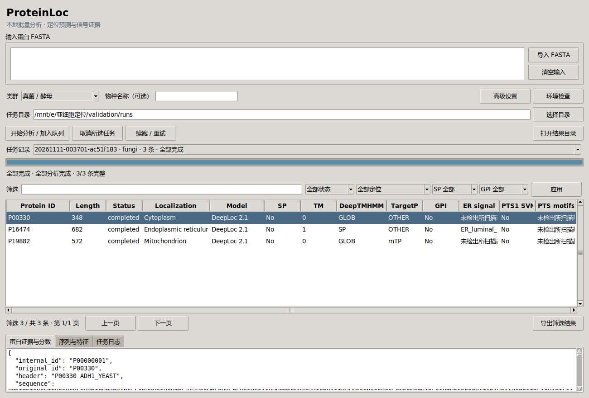

# ProteinLoc

蛋白质亚细胞定位与信号分析桌面应用，使用 Linux、Python 和 Tkinter，在 Windows 上通过 WSL2 / WSLg 运行。导入 FASTA 后，按来源类群调用本地模型，保留各工具的预测、分数、原始输出和独立状态。



## 支持的分析

| 工具或规则 | 分析内容 | 适用任务 |
| --- | --- | --- |
| SignalP 6.0 fast | 信号肽及加工位点 | 真核、原核 |
| Phobius 1.01 | 跨膜拓扑与信号肽 | 真核、原核 |
| DeepLoc 2.1 Fast | 多标签亚细胞定位、定位信号和膜类型 | 真核 |
| DeepLocPro 1.0 | 原核定位，支持阴性菌、阳性菌、古菌及未知原核分组 | 原核 |
| TargetP 2.0 | N 端靶向肽及切割位点 | 真核 |
| PredGPI | GPI 锚定候选与 omega 位点 | 真核 |
| DeepTMHMM 1.0 Academic | α / β 跨膜区域、信号肽及逐残基拓扑 | 真核、原核 |
| oKoch PTS1 SVM 复现模型 | C 端 14 aa 的 PTS1 候选与有符号决策值 | 真核 |
| ER 与 PTS 基序规则 | ER 回收、PTS1 / PTS2 候选基序和位置 | 真核 |

共八个预测工具或模型，加上 ER、PTS 两类规则。真核任务执行九项，原核任务执行四个适用模块。默认复用固定版本的 metaLoc 核心，输入范围不同的工具分别运行。

界面支持队列、取消、续跑、历史任务、筛选、单蛋白详情、序列特征和 JSON / TSV / Excel 导出。各模型独立报告证据，状态区分完成、失败、输入不适用和类群不适用。

## 安装与启动

自动安装脚本面向 Ubuntu 24.04。Windows 用户需要先准备 Ubuntu 24.04 的 WSL2 与 WSLg，Linux 桌面需要显示环境。首次安装需要联网。

```bash
git clone https://github.com/sjc88661/ProteinLoc.git
cd ProteinLoc
sudo apt-get update
sudo apt-get install -y git curl openjdk-21-jre-headless perl python3-tk fonts-noto-cjk
bash scripts/setup.sh
bash run.sh
```

项目包含源码、测试、示例及约 22 KB 的 PTS1 复现权重。其余模型使用各工具的独立发行包，步骤与文件名见 [模型安装说明](MODEL_SETUP.md)。补齐模型后，可在“环境检查”核对所有本地入口。

Windows 中也可双击 `run.bat`，默认使用名为 `Ubuntu` 的 WSL 发行版。GUI 环境默认保存在 `~/.local/share/proteinloc`，项目目录保存源码与配置。首次安装可用 `PROTEINLOC_RUNTIME` 指定运行环境位置。

## 使用

1. 导入 FASTA 或粘贴蛋白序列，选择来源类群，可填写物种名称。
2. 选择任务目录，点击“开始分析 / 加入队列”。应用一次执行一个任务，其余任务排队。
3. 从任务记录查看状态，按定位、信号肽、GPI、状态或关键词筛选。
4. 选择蛋白查看模型分数、信号区域、原始输出位置和序列。
5. 使用“导出筛选结果”生成独立的 JSON、TSV 和 Excel 文件。

关闭窗口时可以选择后台继续或取消。后台任务依赖 WSL 持续运行，系统重启后的中断任务可手动续跑。续跑核对输入、参数、模型文件和版本，复用匹配的缓存，并归档上一轮核心输出及轨迹。

```bash
bash scripts/python.sh pipeline.py doctor
bash scripts/python.sh pipeline.py submit examples/signals.fasta --organism fungi --wait
bash scripts/python.sh pipeline.py submit bacteria.fasta --organism gram_negative --wait
bash scripts/python.sh pipeline.py status runs/<任务ID>
bash scripts/python.sh pipeline.py resume runs/<任务ID>
bash scripts/python.sh pipeline.py cancel runs/<任务ID>
```

类群可选 `fungi`、`plant`、`animal`、`other_euk`、`gram_negative`、`gram_positive`、`archaea`、`prokaryote` 和 `unknown`。

## 输入与结果

每条序列分配唯一内部 ID，保留原始 header 和完整序列。重复 ID、非法字符、特殊残基、模型长度限制、实际提交序列、残基变更与分析区段均逐条记录。多个工具按内部 ID 合并。

- SignalP 本地 fast 模式分析 N 端前 70 aa。DeepLoc Fast 配置上限为 1,022 aa。
- DeepLocPro 配置范围为 10–6,000 aa，已完成一条 1,077 aa 全长输入的本机验证。
- PredGPI 接收至少 41 aa 的标准氨基酸输入。
- PTS1 SVM 分析真实 C 端 14 aa，保留 U / X，未建模的 C 端残基逐条报告。

`completed` 表示输出通过完整性检查。适用的必需模型失败或输入超出范围时，任务保持 `partial`。明确标记 `applicable=false` 的类群专用模块不影响适用模块的完成判定。基序和 SVM 结果均属于候选证据，决策值按原始含义保存。

每个 `runs/<任务ID>/` 保存输入、ID 映射、任务状态、日志、模型原始输出、缓存和汇总文件。结果结构由 [parsers.py](parsers.py) 和 [pipeline.py](pipeline.py) 实现。

## 配置

`config.json` 保存模型路径、命令、输入范围和资源设置，可通过“高级设置”编辑。命令采用参数列表，支持 `{root}`、`{python}`、`{input}`、`{output}`、`{targetp_organism}`、`{signalp_organism}`、`{metaloc_organism}` 和 `{deeplocpro_group}` 占位符。

默认 `core_engine=metaloc`，已有独立工具也可设置 `core_engine=commands`。来源和固定版本见 [upstream.lock.json](upstream.lock.json)。

## 验证

准备基础环境和上游源码后，可运行回归测试。

```bash
bash scripts/python.sh -m unittest discover -s tests -v
```

发布前从纯源码快照执行了 73 项用例，71 项通过，2 项因需要完整本地模型包而跳过。此前还完成了 3 条公开酵母蛋白的真核九模块联合运行、50 条合成蛋白的原核四模块联合运行，以及 PTS1 权重数值与内部交叉验证复核。范围、环境和解释见 [验证说明](docs/VALIDATION.md)。GUI 测试需要 WSLg / X11，部分真实工具测试需要相应模型。

`tests/fixture_tool.py` 为回归提供受控格式样本，完整模型的准备与实跑步骤见模型说明。

## 许可证与引用

自有代码采用 [MIT](LICENSE)。PTS1 复现模型及适配代码保留 [BSD-3-Clause](tools/pts1/LICENSE) 声明。外部工具按各自许可证获取和使用，科研引用与来源见 [THIRD_PARTY.md](THIRD_PARTY.md)。
